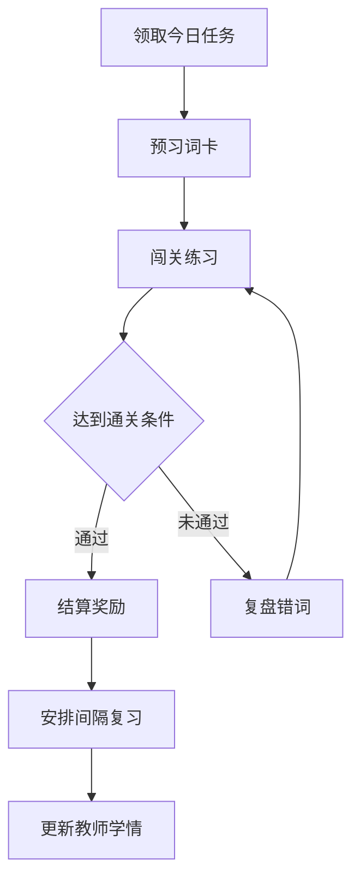
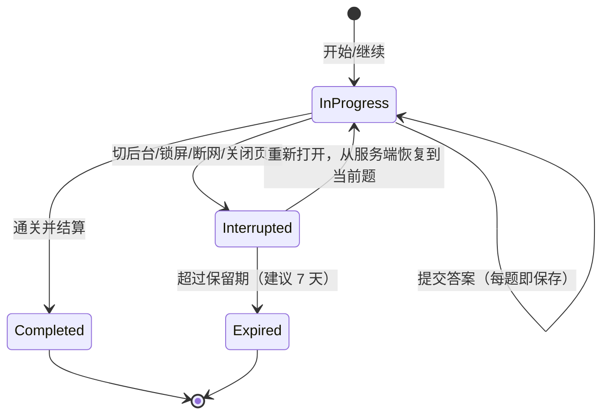
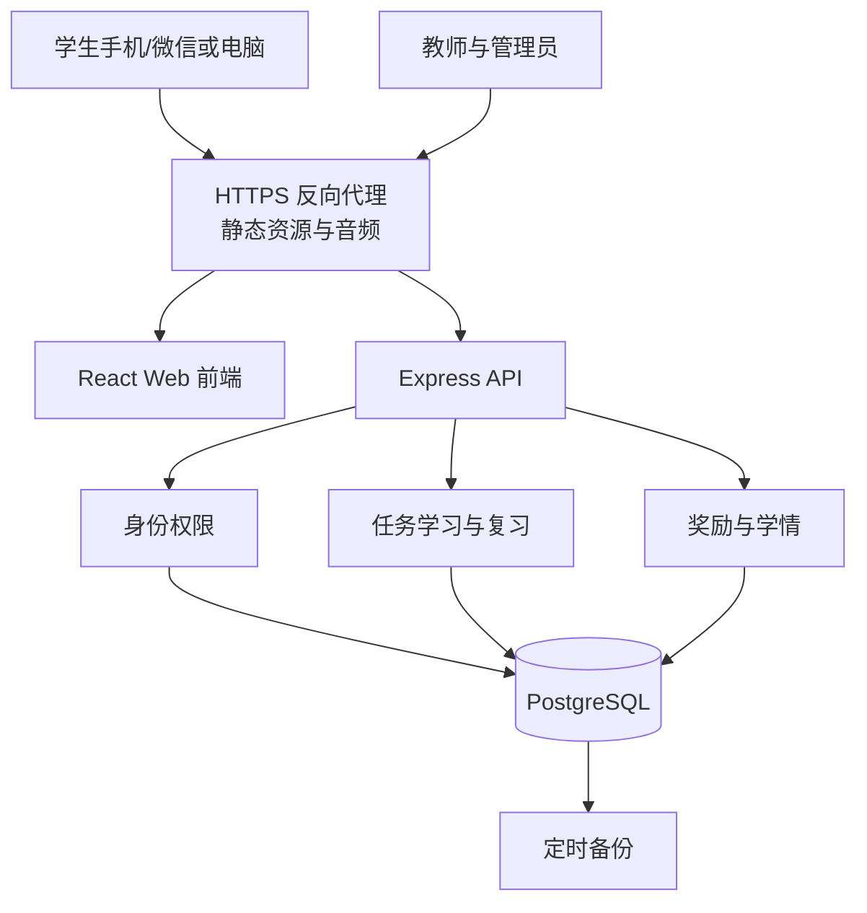

# 单词特训营 — 中职英语游戏化学习平台开发文档

> 版本：v1.1 | 日期：2026-11-22 | 状态：开发规格（尚未实现）
>
> 相对 v1.0 的主要变化：明确“手机为主、电脑兼容”的设备策略并新增第 7 章（多端适配与移动端规范）；核对上游项目并细化改造点；补全每日任务、FSRS 评分、掌握状态等规则定义；修正数据模型与 API 的不一致；补充测试、容量、合规与风险。变更清单见附录 A。

## 1. 项目定位

为中职学生打造一个低门槛、可持续、有成就感的英语单词学习平台。通过每日短时学习、关卡挑战和成长奖励，帮助基础薄弱或学习动力不足的学生建立记忆习惯；教师可统一布置任务并查看班级学情。

产品不追求学生刷大量题目，而追求有效记忆、持续学习和个体进步。

| 用户 | 需求 |
| --- | --- |
| 学生 | 每天 5–10 分钟；手机单手可操作；反馈及时；碎片时间可随时中断和继续；看得到成长 |
| 英语教师 | 导入教材词汇、布置任务、查看学生完成率和难词、快速找到今日未完成的学生 |
| 管理员 | 账号、权限、班级管理、数据备份与系统维护 |

### 1.1 设备策略

| 终端 | 使用者 | 优先级 | 策略 |
| --- | --- | --- | --- |
| 手机（Android / iOS，含微信内置浏览器） | 绝大多数学生 | **主要** | 所有学生端功能以手机为设计和验收基准 |
| 电脑浏览器（Chrome / Edge） | 约 1–3 名学生（可能是学校机房或共用电脑）、教师、管理员 | 兼容 | 学生端与手机共用同一套响应式页面，不单独设计第二套界面；教师和管理员端以桌面为主 |
| 平板 / 其他 | 无专门用户 | 不专门适配 | 响应式布局不破版即可 |

原则：**一套代码、一套学生端界面**。电脑端学生只需做到“完整可用”：学习区居中显示、支持键盘操作（见 7.4），不为 1–3 名学生增加额外开发量；资源冲突时优先保证手机体验。

### 1.2 设计原则

- 年轻、现代、有竞技感，不幼稚化；中文界面为主。
- 短任务、小步学习、循序渐进；答错给提示和重试机会。
- 奖励真实学习、有效复习和个人进步，不鼓励机械刷分。
- 手机优先，兼容电脑及微信内置浏览器，无需安装 App。
- 随时可中断：每答一题即保存，切后台、锁屏、断网后都能回到原位继续。
- 默认保护学生成绩隐私，公开展示应以正向成果、昵称和自愿参与为主。

### 1.3 试点成效指标

| 指标 | 定义 | 建议目标 |
| --- | --- | --- |
| 每周参与率 | 本周至少完成一次任务人数 / 有效班级人数 | ≥80% |
| 每日完成率 | 当日通过任务人数 / 应完成任务人数 | ≥70% |
| 7 日坚持率 | 试点首日参与学生中，第 7 日仍完成任务者比例 | ≥60% |
| 掌握提升 | 同词集初测和延迟复测的正确率变化 | 较基线提升 |
| 单次任务用时 | 每名学生每日任务总时长的中位数 | ≤10 分钟 |
| 中途退出率 | 开始后未完成当日任务的会话占比 | 作为观察指标，试点后设目标 |
| 听音可用率 | 听音题成功播放次数 / 听音题总数 | ≥95%（低于则优先修复音频方案） |

目标由试点教师根据班级实际情况调整。除学习指标外，后台同时按终端类型（手机 / 电脑 / 微信内置浏览器）记录用时、出错和退出情况，用于发现适配问题。

## 2. 开源选型

| 项目 | 源码及体验 | 使用策略 |
| --- | --- | --- |
| Vanilla Class SRS | [GitHub](https://github.com/jpasden/vanilla-class-srs) | 首选基础，MIT；复用班级、教师、任务、FSRS、学情 |
| TypeWords | [GitHub](https://github.com/zyronon/TypeWords) / [体验](https://typewords.cc) | GPL-3.0；仅借鉴跟写、听写、默写、错词的交互思路 |
| Qwerty Learner | [GitHub](https://github.com/RealKai42/qwerty-learner) | GPL-3.0；仅借鉴拼写、发音与输入反馈的交互思路 |
| Habitica | [GitHub](https://github.com/habitrpg/habitica) | 借鉴金币、升级、养成、每日任务；不直接合并整套代码 |
| ClassQuiz | [GitHub](https://github.com/mawoka-myblock/ClassQuiz) | MPL-2.0；后续参考课堂竞赛 |
| Vocabulary Trainer | [GitHub](https://github.com/phinaldoo/vocabulary-trainer) | MIT；备选基础，多用户、统一词库、独立进度 |
| English Wordlists | [GitHub](https://github.com/mahavivo/english-wordlists) | 词表参考，导入前审核来源、内容及授权 |

### 2.1 上游核对结果（Vanilla Class SRS，2026-11-22 查看仓库首页）

| 项目 | 现状 | 对本项目的影响 |
| --- | --- | --- |
| 技术栈 | React + Vite 前端、Node.js + Express 后端、Prisma + PostgreSQL、Docker Compose；共享目录含类型与 FSRS 引擎 | 与本文第 8 章技术方案一致，改造成本低 |
| 调度 | FSRS v5，服务端按“卡组”调度 | 可直接复用，需补充 4.1 的评分映射 |
| 进度隔离 | 每个入班关系（enrollment）一个独立卡组，同一学生在不同班级进度互不影响 | 本项目 `word_progress` 的 `context_id` 即对应入班关系；试点阶段一名学生一个班，等价 |
| 教师功能 | CardSet 与 CSV 导入、班级任务（必做/选做）、掌握矩阵、排行榜、准确率热力图、作业达标跟踪 | 覆盖教师端大部分需求，需检验手机端是否可读 |
| 登录 | 邮箱 + 密码，用邮件重置密码 | **需改造**：学生通常没有邮箱，改为教师分配用户名；重置密码由教师/管理员操作 |
| 部署 | 有自托管文档，含国内云部署说明 | 上线前阅读并核对 |
| 许可证 | MIT | 允许修改和私有部署，需保留许可证声明 |
| 社区 | 仓库首页显示 0 star、0 fork、130 次提交 | 不能指望上游修复问题，必须把质量验证做在第 0 阶段 |
| 未覆盖 | 无 Boss 关、拼写闯关、听音、金币/等级、手机端专项适配（未核实时均按“无”处理） | 属于本项目新增范围 |

### 2.2 选型策略

**开发策略：** 优先基于 Vanilla Class SRS 创建独立分支，保留师生管理、班级词集、作业和间隔复习功能，改造学生端并新增激励系统。因上游社区很小，第 0 阶段必须先启动原版并完成下表验证，第 1 周结束前做 Go / No-Go 决策：多项关键验证不通过时，使用同技术栈独立实现，并只参考上游的数据模型。

| 验证项 | 通过标准 |
| --- | --- |
| 启动与部署 | 按文档在干净环境用 Docker 一次启动成功，可创建管理员 |
| 权限隔离 | 学生 A 无法读取学生 B 的记录；教师无法查看非授课班级（写成自动化用例） |
| FSRS 正确性 | 对若干固定输入，调度结果与参考实现一致；时间边界（跨日）无异常 |
| 中文与导入 | UTF-8（含 BOM）CSV 导入中文无乱码；错误行能定位 |
| 手机可用性 | 用目标真机（含微信）打开学生页面，评估布局、触控、软键盘是否可用 |
| 登录改造可行性 | 去除邮箱依赖、改为用户名登录的改动范围可评估 |
| 代码质量 | 有基本测试、类型检查通过、依赖无高危漏洞 |

**代码管理要求：**

- 固定上游基准提交，改动尽量以新增模块和新增数据库迁移为主，少改上游核心文件，便于日后对比和合并。
- 维护第三方许可证清单；词典、例句、图片和音频的授权单独确认并记录来源。
- GPL-3.0 项目（TypeWords、Qwerty Learner）只借鉴交互与产品思路，**不复制其代码**；如确需复用，先评估对本项目整体许可证和分发方式的影响。
- 上述为目标方案，并不代表上游已实现全部新增功能。

## 3. 开发版本范围

| 优先级 | 功能 | 目标版本 |
| --- | --- | --- |
| P0 | 登录、班级、词库、任务、背词闯关、错词、智能复习、积分、基础学情；**手机适配与微信真机验证、断点续学、音频分层降级、“报告问题”入口** | V1.0 MVP |
| P1 | 连续打卡、徽章、进步榜、每周挑战、虚拟商城；评估“添加到主屏幕”与离线缓存 | V1.1 |
| P2 | 角色/宠物养成、装备、班级战队、课堂实时竞赛、专业情景学习 | V1.2+ |

首版追求完整的真实学习闭环，不强制接入 AI、微信授权登录、支付、实时竞技或完整离线学习。

## 4. 功能需求

### 4.1 学生端

| 页面 | 功能 |
| --- | --- |
| 登录/加入班级 | 教师分配账号、扫码或链接进入、首次改密、班级邀请码；默认保持登录 30 天，电脑端提供“公共电脑”选项 |
| 首页 | 今日任务、到期复习、连续学习状态、XP、等级、继续学习（精确回到上次的题） |
| 闯关地图 | 按单元展示关卡、星级和进度 |
| 单词卡片 | 英文、中文释义、音标、发音、例句、可选图片 |
| 闯关练习 | 选择题、拼写、听音、反馈、提示与重试 |
| 结果页 | 首次正确率、得分、奖励、错词和下一关 |
| 复习中心 | 到期词汇、历史错词、词汇掌握状态 |
| 成长中心 | 等级、经验、金币流水；后续加入徽章和商城 |
| 个人中心 | 学习历史、设置（音效、动效、字号）、改密、隐私选项、“报告问题” |

#### 每日学习流程



#### 学习会话状态



同一学生同一任务同一时间只有一个进行中的会话；已有进行中会话时，“开始学习”返回该会话（幂等）。

#### 每日任务定义

“每日任务”必须有明确定义，否则奖励、完成率和打卡无法统一计算（以下为默认值，教师可调整）：

- **今日新词包**：任务按顺序分配的新词，默认一个单元（10 个词）；完成 L1–L5（听音题不可用时按等价题计）并通过当日 Boss，即视为新词部分完成。
- **今日复习**：当日到期的复习词，默认最多 10 个；完成全部分配的复习词即视为复习部分完成。无到期词时只需完成新词部分。
- **完成每日任务** = 新词部分 + 复习部分均完成。当日完成一次即触发“完成每日任务”奖励（每个自然日一次）。
- 学习日按 Asia/Shanghai（北京时间）自然日计算，数据库统一存 UTC，另存 `study_date`。

#### 时间预算与分段

估算（按每词答题耗时粗算，需试点实测校准）：

| 环节 | 估算用时 |
| --- | --- |
| L1 认识新词（10 词） | 约 1.5 分钟 |
| L2 英译中 + L3 中译英 | 约 2 分钟 |
| L4 听音辨词 | 约 1.5 分钟 |
| L5 拼写 | 约 2.5 分钟 |
| Boss 综合关 | 约 1.5 分钟 |
| 到期复习（10 词） | 约 1.5 分钟 |
| 合计（不含重试） | 约 10–11 分钟 |

据此作出两项设计：

1. **分段保存**：任务分成 3 小段（认词 L1–L3 / 听拼 L4–L5 / Boss + 复习），每段约 3–4 分钟，完成一段即有反馈，适合课间和碎片时间。
2. **渐进上量**（建议默认，教师可改）：第 1 周每日 5 新词 + 5 复习，第 2 周 8 + 10，第 3 周起 10 + 10，避免基础薄弱学生一开始就被压垮而放弃。

#### 闯关题型

每单元默认 10 个词，教师可按班级能力设置 5–20 个。

| 关卡 | 题型 | 说明 |
| --- | --- | --- |
| L1 认识新词 | 词卡、跟读、看图识词 | 先展示词义和例句；无图片时仍可学习 |
| L2 英译中 | 四选一 | 依据英文选择中文释义 |
| L3 中译英 | 四选一 | 依据中文选择英文 |
| L4 听音辨词 | 听音选择 | 允许重播；音频不可用或学生当下不便听音时，切换为等价题且不影响奖励与通关 |
| L5 拼写 | 中文提示或听写 | 输入完整单词；支持预定义的正确词形 |
| Boss 综合关 | 混合客观题 | 无答案提示下完成综合测试 |

通关规则：基础关默认正确率达到 70%，Boss 默认 80%；教师可调整。首次独立答题和提示后重试分别统计。三颗星分别对应通关、首次正确率达到 90%、首次正确率 100%。不默认强制限时，避免将打字速度等同于记忆水平。

#### 出题与判分规则

- **干扰项**：取自同词库、同词性、相近难度的词，每题 3 个；排除近义词、同一单词的其他义项，保证只有一个正确答案。
- **服务端固定题目**：题目和选项顺序在生成时写入会话，刷新或恢复后不变；标准答案不下发到客户端。
- **拼写判分**：去首尾空格、忽略大小写、合并连续空格（支持 ice cream 一类短语）；允许教师预设的正确变体（如 colour / color）；不接受缺字、多字。拼写与正确答案仅差一个字符时，提示“很接近了”并允许重试，首次仍按答错记。
- **提示**：拼写提供“首字母 → 逐字母”两级提示，选择题可排除一个错误选项；每次使用提示都记录（`hint_level`）。
- **答错处理**：同一题最多重试 2 次；第 3 次展示正确答案并记为错误，该词进入错词；关卡结束后对错词再练一轮，再次未通过时错词优先重新出题，避免无意义重复。
- **中文输入法**：拼写框在输入法组合输入（composition）期间不判分、不提交。

#### 智能复习

- 使用 FSRS 间隔重复调度算法，维护学生独立的记忆状态与下次复习日期。
- 默认每天 10 个新词 + 10 个到期复习词，由教师调整（见“渐进上量”）。
- 区分无提示首次答对、提示后答对、错误及重试，按独立回忆结果评分。
- 错词进入复习队列；已掌握词汇仍需按算法进行间隔复习。

**FSRS 评分映射（暂定，试点后校准）：**

| 作答结果 | 评分 |
| --- | --- |
| 首次独立答对 | Good |
| 提示后答对，或重试后答对 | Hard |
| 最终答错，或展示答案 | Again |
| Easy | 默认不启用（避免把答题速度当作掌握程度） |

**每个词每次学习/复习只产生一次调度评分**：以该词“最终独立回忆题”的结果为准（有拼写取拼写，否则取 L3 中译英）；同一次会话中该词的其他题型只写入答题记录，不触发调度，避免同日多次评分扭曲间隔。

**单词掌握状态（暂定，阈值可配置，试点后校准）：**

| 状态 | 判定 |
| --- | --- |
| 未学习 | 无学习记录 |
| 学习中 | 已学习，调度处于学习/重学阶段，或稳定性尚低 |
| 待复习 | 已到期（`due_at` ≤ 当前时间） |
| 已掌握 | 复习阶段、稳定性达到阈值（建议起点 21 天）且最近一次复习未失败 |

一次答对不视为长期掌握；状态由调度数据派生，可缓存，不作为独立事实来源。

**复习积压处理**：学生缺勤或断更后，到期词可能堆积。每日复习有上限，按遗忘风险（逾期程度、历史失误）排序取前 N 个；积压超过上限 3 倍时提示“今天先复习最重要的 N 个”，不向学生展示庞大的待办数字；教师可对班级执行“积压重置”（记录审计日志）。

### 4.2 教师端

教师端以电脑为主要使用设备；手机只保证查看关键统计（今日完成率、未完成名单）可读。

| 模块 | 主要功能 |
| --- | --- |
| 班级管理 | 创建班级、邀请码/二维码、批量新增学生（导出账号卡，初始密码随机生成）、重置学生密码、停用成员 |
| 词库管理 | 创建词库、单元、CSV/Excel 导入、编辑、预览、发布；音频生成状态查看 |
| 任务管理 | 选择词集、题型、开始及截止时间、通关条件、每日目标 |
| 学情看板 | 班级完成率、个人完成状态、**今日未完成名单（用于私下提醒）**、首次正确率、高频错词、待复习人数 |
| 学生详情 | 每日任务、学习趋势、掌握词数、复习情况 |
| 奖励管理 | 配置奖励额度和每日上限、查看流水 |
| 报表导出 | 导出授权班级的 CSV/XLSX 学习报告 |

任务状态：草稿 → 已发布 → 已结束/已撤回。任务发布时冻结词汇与规则版本，后续教师编辑不得修改之前的评分。学生逾期仍可自学，报表需区分按时完成与逾期完成。

### 4.3 管理员端

- 开通、停用教师账号；分配角色和班级权限。
- 配置年级、专业、学期、全局奖励规则。
- 数据备份、恢复和管理操作日志。
- 提供符合学校数据管理要求的导出、归档和删除方式。

## 5. 游戏化激励

### 5.1 经验与金币

| 学习行为 | XP | 金币 | 结算限制 |
| --- | ---: | ---: | --- |
| 新词首次达到学习标准（在 L2/L3 首次独立答对） | 10 | 0 | 每学生每词一次 |
| 到期复习首次独立答对 | 5 | 0 | 每词每复习周期一次 |
| 首次通关指定 Boss | 20 | 10 | 每任务版本一次 |
| 完成每日任务（定义见 4.1） | 20 | 50 | 每个自然日一次 |
| 连续完成 7 日任务 | 30 | 30 | 每个连续周期一次（V1.1） |
| 重复已通关关卡 | 0 | 0 | 自由练习仍记录有效学情 |

默认每日奖励上限 250 XP、100 金币，可由教师调整。达到上限后仍可学习。经验不因答错减少；金币仅用于虚拟道具，不与真实货币互换。

默认配置下的单日理论最高：10 新词 × 10 + 10 复习 × 5 + Boss 20 + 每日任务 20 = 190 XP；金币 10 + 50 = 60（遇 7 日连续奖励时为 90），均在上限之内，上限只在教师调高题量时才起作用。

所有奖励由服务端验证并结算，不接受客户端提供的得分或奖励金额。每笔奖励需有唯一事件键、结算原因和时间。事件键约定：

| 奖励 | 事件键格式 |
| --- | --- |
| 新词达标 | `word_learned:{context_id}:{word_id}` |
| 复习答对 | `review_ok:{context_id}:{word_id}:{cycle_start_date}` |
| Boss 首通 | `boss_clear:{assignment_id}:{version}:{boss_id}` |
| 每日任务 | `daily_done:{study_date}` |
| 连续 7 日 | `streak7:{streak_start_date}` |

**异常作答标记**：作答耗时异常短（如连续多题低于 1 秒）、批量重复提交等，只在教师端标记供参考，不自动扣分或封号；奖励仍由唯一事件键和每日上限控制。

### 5.2 等级与称号

| 等级 | 累计 XP | 称号 |
| --- | ---: | --- |
| Lv.1 | 0 | 词汇新兵 |
| Lv.2 | 100 | 学习先锋 |
| Lv.3 | 300 | 词汇达人 |
| Lv.4 | 600 | 英语挑战者 |
| Lv.5 | 1000 | 单词高手 |
| Lv.6 | 1600 | 特训营精英 |
| Lv.7 | 2400 | 词汇指挥官 |
| Lv.8 | 3400 | 单词大师 |
| Lv.9 | 4600 | 英语王牌 |
| Lv.10 | 6000 | 词汇传奇 |

说明：按每日约 100–190 XP 估算，Lv.6 约在 2–3 周达到，原 6 级对持续学习的学生会过早“封顶”，故扩展到 10 级。阈值在试点两周后按实际日均 XP 校准。

### 5.3 排行榜与养成（V1.1+）

- 进步榜：在同难度词集上比较近期正确率相对基线的提升；设置最少有效样本，基础薄弱学生也有机会进榜。
- 坚持榜：按每周完成任务天数评价，不计重复点击。
- 小组挑战：班级小组共同完成学习目标，解锁集体奖励。
- 徽章：首次任务、坚持三天、坚持七天、复习达人、拼写高手。
- 连续学习按北京时间自然日计算；允许教师配置休息日或适当补签。
- 公开排名仅展示自愿参与者的昵称或小组成果，不展示实名错误率和末位名单；昵称需过敏感词；完整数据仅供授权教师。
- 后续通过金币兑换角色装备、宠物、背景等，不引入付费抽奖或付费学习优势。

## 6. 词库设计

| 词库类型 | 示例 |
| --- | --- |
| 中职公共英语 | school, family, study, work, health |
| 汽修 | engine, brake, battery, wheel |
| 计算机 | keyboard, software, network, file |
| 电子商务 | order, customer, product, price |
| 酒店旅游 | guest, service, reservation, room |
| 烹饪 | ingredient, menu, knife, recipe |
| 护理 | patient, medicine, temperature, care |

首版采用教师审核的课本词表，按册次、单元、专业及难度组织。专业词汇和例句由专业或英语教师审核，避免生硬翻译。

### 6.1 CSV 导入模板

UTF-8 编码，必填列：word、meaning_zh、unit，其余可选。`variants` 填写允许的其他正确拼写，用 `|` 分隔。

```csv
word,meaning_zh,unit,phonetic,pos,example_en,example_zh,category,difficulty,variants
engine,发动机,Unit 01,,n.,The engine is running.,发动机正在运转。,汽修,1,
color,颜色,Unit 03,,n.,My favorite color is blue.,我最喜欢的颜色是蓝色。,公共,1,colour
```

导入流程：上传 → 格式校验 → 错误预览 → 教师确认 → 写入草稿 → 发布。

- 错误行标注行号和原因；按词库、单元、标准化词形及义项去重，不能把同形异义词直接覆盖。
- **编码兼容**：中文 Excel 另存的 CSV 常为 GBK 编码，导入时检测编码（UTF-8 / UTF-8 BOM / GBK），无法识别时给出明确提示，不静默导入乱码。
- 导入限制文件大小与行数；导入仅在电脑端教师页面提供，手机和微信内置浏览器不开放上传。
- 修改已发布词条产生新版本（见第 9 章 `word_versions`），已发布任务继续使用旧版本。

### 6.2 音频与图片素材

- 发音以**预生成音频文件**为主（见 7.6）：词表发布时批量生成并存放在服务器静态目录，单个音频控制在约 30KB 以内。
- 每个素材记录来源和授权状态；授权不明的音频、图片不得上线。
- 无图片、无音频时，词卡和题目仍能正常完成。

## 7. 多端适配与移动端规范

本章是 v1.1 的核心新增内容。所有学生端功能按本章验收。

### 7.1 支持范围

具体机型与系统版本以**试点班级的设备调查结果**为准（上线前让学生登记手机品牌、系统版本、平时用什么打开链接）。在调查前，暂按下表执行：

| 环境 | 要求 |
| --- | --- |
| iOS Safari / 微信内置浏览器 | 必须通过关键流程真机测试 |
| Android Chrome / 微信内置浏览器 / 国产手机自带浏览器 | 必须通过关键流程真机测试，重点覆盖华为、小米、OPPO、vivo 等主流机型 |
| 桌面 Chrome / Edge（较新版本） | 必须通过关键流程测试（1–3 名学生与教师使用） |
| 桌面 Safari / Firefox | 不专项测试，基本可用即可 |
| 旧版 IE | 不支持 |

### 7.2 响应式布局

| 断点 | 布局 |
| --- | --- |
| ≤480px（手机，基准 360×640，兼容 320 宽） | 单列；底部导航；主操作按钮固定在底部拇指区 |
| 481–1023px（大屏手机/平板） | 同手机布局，内容区居中 |
| ≥1024px（桌面） | 学习区居中，宽度上限约 480–560px，两侧留白；保持同一套组件和底部导航，不做第二套界面 |

- 教师/管理员页面以 ≥1024px 为设计基准，表格和筛选为主；手机只保留关键统计的只读视图。
- 手机、平板、桌面均不得出现整页横向滚动；横屏不强制锁定，但不得破版。
- 使用系统字体栈，不加载中文网络字体（体积过大）。
- 适配刘海与手势条：使用 `env(safe-area-inset-*)`；高度用 `dvh`，避免移动浏览器地址栏伸缩造成跳动。

### 7.3 触控与输入

- 触控目标不小于 44×44 CSS 像素，相邻目标间距不小于 8px；选择题选项使用整行大按钮。
- 主操作（提交、下一题）放在屏幕下半部；一屏一题，题目页不需要滚动即可看到题干、选项和主按钮。
- 输入框字号不小于 16px（避免 iOS 聚焦时自动放大页面）。
- 拼写输入框设置：关闭自动大写、自动纠错、拼写检查、自动填充（`autocapitalize="none"`、`autocorrect="off"`、`spellcheck="false"`、`autocomplete="off"`）。
- 软键盘弹出时，输入框和提交按钮必须仍可见（用 `visualViewport` 或 `dvh` 处理），不被键盘遮挡。
- 不依赖自动聚焦弹出键盘（iOS 需要用户手势）；进入拼写题后由学生点击输入框。
- 提交后按钮立即禁用，约 300ms 内不响应重复点击；设置 `touch-action: manipulation` 避免双击缩放。
- 不把悬停、长按、拖拽作为唯一操作方式；不依赖震动（iOS 不支持），震动仅作可选增强。

### 7.4 电脑端补充（面向 1–3 名电脑学生）

- 键盘：数字键 1–4 选择选项，Enter 提交/下一题，空格重播发音；拼写框默认可直接键盘输入。
- Tab 焦点顺序合理、焦点样式可见；鼠标悬停态仅为增强。
- 多人共用电脑时，登录页提供“这是公共电脑”选项：不持久保存登录，关闭浏览器或 12 小时后失效；退出登录入口在个人中心明显可见。

### 7.5 微信内置浏览器

| 问题 | 要求 |
| --- | --- |
| 访问入口 | 二维码 + 链接；必须 HTTPS。部署在中国大陆服务器并使用自有域名时，需按云厂商和监管要求完成域名备案；上线前用微信实机确认链接可正常打开、无拦截提示 |
| 登录态 | 使用 HttpOnly + Secure + SameSite 的 Cookie；不依赖浏览器本地存储保存学习进度 |
| 页面被回收/切后台 | 微信可能回收页面，所有进度以服务端为准；在 `visibilitychange` / `pagehide` 时尽力提交未发送的答案；回到页面从服务端恢复当前题 |
| 返回手势/返回键 | 学习过程中返回给出确认提示，避免误退；使用 history 状态管理，防止返回回到登录页 |
| 缓存与版本 | 静态资源文件名带 hash；`index.html` 禁止强缓存；检测到客户端版本过旧时提示刷新（见第 10 章 `X-Client-Version`） |
| 授权与分享 | V1 不接入微信授权登录，不依赖微信 JS-SDK，不做分享功能 |
| 文件上传/下载 | 学生端无文件操作；教师导入导出请用电脑浏览器 |

### 7.6 发音与音频（分层降级）

浏览器自带语音合成（speechSynthesis）在不同机型、系统和微信内置浏览器中的可用性差异很大，**不能假设可用**，因此采用分层方案：

| 层级 | 方案 | 说明 |
| --- | --- | --- |
| 1 首选 | 预生成音频文件 | 词表发布时批量生成（离线语音合成或有授权的词典音频），存服务器静态目录；使用兼容性好的 mp3/aac；授权单独确认 |
| 2 兜底 | 浏览器语音合成 | 仅当音频文件缺失且检测到可用的英文语音时使用 |
| 3 降级 | 非听力题 | 以上都不可用时，该词的听音题自动替换为等价的 L2/L3 题，不扣奖励、不影响通关 |

要求：

- 播放必须由用户点击触发，不自动播放；首次进入听音题前有“点击开始”交互。
- 提前预加载下一题音频；单次音频播放失败时给出“重试 / 暂时跳过”选项。
- 听音题开始前提示“请打开声音或戴耳机”，并提供“现在不方便听音”按钮，课堂和宿舍场景下可无惩罚切换为等价题。
- 流量控制：音频按需加载，优先预取当前单元；单次任务的非音频流量控制在约 1MB 以内。

### 7.7 弱网与中断

- 不做完整离线学习（V1）：判分在服务端，离线答题会与“服务端判分与奖励结算”冲突。
- 每题提交即落库；提交失败时客户端自动重试（同一 `submissionId`，最多 3 次，请求超时约 8 秒），仍失败则保留当前题并提示“网络不稳定，恢复后会继续”，不丢进度。
- 题目在会话开始时分批预取（不含答案），每题交互只需一次请求；单个响应体积尽量小（建议 ≤5KB）。
- 点击后立即给出本地反馈（按钮禁用 + 轻量加载态），请求超过约 300ms 才显示加载指示。

### 7.8 多设备与并发会话

- 同一账号允许手机和电脑都登录，但同一任务同一时间只有一个可写的进行中会话；在新设备继续时，旧设备再提交答案会收到“已在其他设备继续”的提示。
- 答案请求带 `submissionId`，会话带版本号（`sessionVersion`），服务端用乐观锁防止乱序和重复写入。

### 7.9 性能预算与低端机

目标设备包含 3–4 年前的中低端安卓机。

| 指标 | 目标 |
| --- | --- |
| 学生端首屏 JS | gzip 后 ≤200KB；教师/管理员代码独立分包，不进入学生端首屏 |
| 首次可交互 | 校园 Wi-Fi / 4G 下 ≤3 秒 |
| 题间切换 | 本地响应 ≤100ms（不含网络往返） |
| 动画 | 仅使用 transform / opacity；跟随系统“减少动态效果”，并提供应用内开关 |
| 图表库 | 仅教师端加载，学生端不引入 |

### 7.10 PWA / 添加到主屏幕

V1 不依赖 PWA，也不使用 Service Worker 离线缓存（避免缓存陷阱导致学生停留在旧版本）。V1.1 评估：提供基础的主屏幕图标配置（微信内置浏览器不支持添加，仅对系统浏览器有意义）。

## 8. 技术架构



| 层级 | 技术方案 |
| --- | --- |
| 前端 | React + TypeScript + Vite，响应式移动端优先；学生端与教师/管理员端路由级分包 |
| 后端 | Node.js + Express，TypeScript，模块化 API |
| 数据库 | PostgreSQL + Prisma，约束、事务、迁移与索引 |
| 复习算法 | FSRS，封装调度服务，版本固定；复用上游共享引擎并补单元测试 |
| 发音 | 预生成音频文件为主，浏览器语音合成兜底，再降级为非听力题（见 7.6） |
| 部署 | Docker Compose + HTTPS 反向代理，前后端同源；静态资源启用压缩与缓存策略 |
| 日志与监控 | 结构化日志（脱敏）、健康检查、前端错误上报（附机型/浏览器/版本，不含个人信息） |
| 测试 | 规则单元测试、API 集成测试、手机/电脑端到端测试、真机测试（见第 14 章） |

初步采用一台学校服务器或云主机私有部署；学生通过二维码或链接访问。微信内置浏览器需经过真机验证，不能仅依赖桌面测试。后续可评估校园局域网及独立小程序。

**容量估算（需压测验证）：** 单班 30–60 人同时在线，每人约每 8 秒一次请求，高峰约 8 请求/秒，2 核 4GB 的单机通常足够；按实际并发和多班扩展补充压力测试（建议用脚本模拟 60–200 并发）。

**环境：** 开发、测试（接近生产配置）、生产三套环境分离；生产数据不得用于开发测试。

### 建议目录结构

```text
client/src/
  pages/student/
  pages/teacher/
  pages/admin/
  components/
  features/
server/src/
  modules/           # auth, classes, vocabulary, assignments, study, rewards, reports, audio
  middleware/
  tests/
shared/              # 共享类型、复习和奖励规则
prisma/              # 数据模型、迁移
scripts/             # 音频批量生成、备份与恢复
docs/
docker-compose.yml
```

## 9. 数据模型

实际开发优先映射上游已有实体（上游层级为 Department → SubjectGrade → Class，入班关系即 enrollment），补齐缺失字段，避免重复建模。

| 数据表 | 核心字段与用途 |
| --- | --- |
| users | id, username, nickname, password_hash, role, status, must_change_password, last_login_at；邮箱可选 |
| classes | id, name, grade, major, school_id, owner_id, status |
| class_memberships | class_id, user_id, membership_role, status；成员唯一；即学习上下文（`context_id`） |
| wordbooks | id, title, category, source, status, creator_id |
| units | id, wordbook_id, title, sort_order |
| words | id, unit_id, word, 稳定的词条身份（同形异义按义项区分）, status |
| word_versions | id, word_id, version, word, meaning_zh, variants, phonetic, pos, example_en, example_zh, audio_ref, image_ref, created_at；内容快照，发布后不可改，编辑产生新版本 |
| import_jobs | id, wordbook_id, uploader_id, status, file_hash, error_report_json, created_at |
| assignments | id, class_id, title, status, due_at, rule_json, version |
| assignment_words | assignment_id, word_version_id, sort_order；任务词条快照 |
| study_sessions | id, user_id, assignment_id, mode, state, session_version, client_platform, started_at, last_active_at, ended_at |
| session_questions | id, session_id, word_version_id, question_type, options_json, sort_order；标准答案仅服务端使用，不通过题目接口返回 |
| answer_events | id, session_id, question_id, word_version_id, submission_id, answer, result, hint_level, attempt_no, response_ms, client_platform, submitted_at；只追加，不更新 |
| word_progress | user_id, context_id, word_id, fsrs_state, stability, difficulty, reps, lapses, last_review_at, due_at, mastery_state, first_learned_at |
| review_logs | id, user_id, context_id, word_id, rating, state_before, scheduled_days, reviewed_at；调度审计与后续参数优化 |
| reward_ledger | id, user_id, event_key, reward_type, amount, reason, created_at |
| daily_stats | user_id, study_date, task_completed, new_words_done, reviews_done, first_correct, first_total, time_spent_sec, xp_today, coins_today |
| user_settings | user_id, sound_on, reduce_motion, font_scale, leaderboard_opt_in |
| user_sessions | id, user_id, device_label, is_public_device, created_at, last_seen_at, revoked_at；登录会话/刷新令牌 |
| feedback_reports | id, user_id, route, client_version, user_agent, message, created_at；“报告问题”入口 |
| badges | id, code, title, rule_json；V1.1 |
| user_badges | user_id, badge_id, earned_at；V1.1 |
| audit_logs | id, actor_id, action, entity_type, entity_id, created_at |

**约束与索引：**

- 学习记录归属学生及相应班级/词集；成员 `(class_id, user_id)` 唯一。
- 奖励流水以 `(user_id, event_key, reward_type)` 唯一约束防止重复；余额以流水为准。
- 答题以 `(session_id, submission_id)` 唯一约束保证幂等；`daily_stats` 以 `(user_id, study_date)` 唯一。
- 索引建议：`word_progress(user_id, context_id, due_at)`、`answer_events(session_id, submitted_at)`、`study_sessions(user_id, state)`。
- 答题、任务结算及奖励更新应采用数据库事务，失败后可以安全重试。
- 时间字段统一使用带时区时间并以 UTC 存储；`study_date` 按 Asia/Shanghai 计算后另存。
- 数据保留与归档按学校要求配置；毕业或停用班级的数据按规则归档或删除。

## 10. API 设计

统一 /api/v1 前缀；JSON 请求与响应。以下为建议接口，可兼容上游现有 API。

### 10.1 接口清单

| 方法与路径 | 权限 | 用途 |
| --- | --- | --- |
| POST /auth/login | 公共 | 用户名登录（可带 publicDevice） |
| POST /auth/refresh | 已登录 | 刷新会话 |
| POST /auth/logout | 已登录 | 退出 |
| POST /auth/change-password | 已登录 | 修改密码（首次登录强制） |
| GET /me | 已登录 | 当前账号与角色 |
| POST /classes | 教师/管理员 | 创建班级 |
| POST /classes/join | 学生 | 加入班级 |
| POST /classes/{id}/students/batch | 授权教师 | 批量创建学生并生成账号卡 |
| POST /teacher/students/{id}/reset-password | 授权教师 | 重置学生密码（生成一次性新密码） |
| GET /classes/{id}/students | 授权教师 | 查看班级成员 |
| POST /wordbooks | 教师 | 创建词库 |
| POST /wordbooks/{id}/imports | 授权教师 | 上传并预览词表 |
| POST /wordbooks/{id}/imports/{importId}/confirm | 授权教师 | 确认导入 |
| POST /assignments | 教师 | 创建任务 |
| POST /assignments/{id}/publish | 授权教师 | 发布并冻结任务 |
| GET /student/today | 学生 | 今日任务和复习计划 |
| GET /student/map | 学生 | 闯关地图与星级 |
| POST /study/sessions | 学生 | 开始或继续学习（已有进行中会话则返回该会话） |
| GET /study/sessions/{id} | 会话本人 | 获取题目与进度（用于恢复） |
| POST /study/sessions/{id}/answers | 会话本人 | 提交答案 |
| POST /study/sessions/{id}/hints | 会话本人 | 请求提示（会被记录） |
| POST /study/sessions/{id}/skip-audio | 会话本人 | 听音题不可用/不便时切换为等价题 |
| POST /study/sessions/{id}/complete | 会话本人 | 任务结算 |
| GET /student/review | 学生 | 到期词列表 |
| GET /student/mistakes | 学生 | 错词列表 |
| GET /student/rewards | 学生 | 经验、余额、奖励流水 |
| POST /feedback | 已登录 | 提交问题反馈（自动附带机型、版本、页面） |
| GET /teacher/classes/{id}/dashboard | 授权教师 | 班级学情 |
| GET /teacher/classes/{id}/pending-today | 授权教师 | 今日未完成名单 |
| GET /teacher/classes/{id}/export | 授权教师 | 导出报告 |

### 10.2 约定

- 请求头 `X-Client-Version`：服务端发现版本过旧时返回 `CLIENT_OUTDATED`，前端提示刷新。
- 时间使用 ISO 8601（UTC）；列表接口使用游标分页。
- 统一错误格式：`{ "code": "...", "message": "...", "requestId": "..." }`。

| code | HTTP | 含义 |
| --- | ---: | --- |
| UNAUTHORIZED | 401 | 未登录或会话失效 |
| FORBIDDEN | 403 | 无权访问该对象 |
| NOT_FOUND | 404 | 资源不存在或不可见 |
| VALIDATION_ERROR | 422 | 参数不合法 |
| SESSION_FINISHED | 409 | 会话已结束 |
| SESSION_TAKEN_OVER | 409 | 已在其他设备继续 |
| RATE_LIMITED | 429 | 请求过于频繁 |
| CLIENT_OUTDATED | 426 | 客户端版本过旧，需刷新 |

### 10.3 提交答案

请求示例：

```json
{
  "questionId": "q_102",
  "answer": "engine",
  "submissionId": "01JEXAMPLE",
  "sessionVersion": 11,
  "responseMs": 4200
}
```

响应示例：

```json
{
  "correct": false,
  "firstAttempt": true,
  "attemptNo": 1,
  "retryAllowed": true,
  "revealAnswer": null,
  "feedback": "很接近了，再试一次",
  "progress": { "completed": 3, "total": 10 },
  "canContinue": false,
  "sessionVersion": 12
}
```

- 标准答案在提交前不通过题目 API 暴露；仅当重试次数用尽时 `revealAnswer` 才返回答案。提示操作必须记录。
- `submissionId` 由客户端生成并在重试时保持不变；重复 `submissionId` 返回已有结果，不重复计分。
- `responseMs` 仅作统计参考，不参与判分和奖励。
- 提交带 `sessionVersion`，版本不匹配时返回 `SESSION_TAKEN_OVER` 或当前最新状态，由客户端同步。

### 10.4 限流策略

学校出口常见多名学生共用同一 IP，登录限流必须兼顾：**账号维度严格、IP 维度宽松**。例如同一用户名连续失败 5–10 次后短时锁定，同一 IP 仅在极高频率时限速；具体阈值上线前按班级人数调整。登录失败提示统一，不泄露账号是否存在。

## 11. UI/UX 规范

- 视觉：深蓝/靛蓝主色，明亮橙或青色奖励点缀，清爽、青春、富有挑战感。
- 学生首页优先展示今日任务、开始闯关按钮和进度条，底部导航：首页、闯关、复习、我的。
- 一屏一道题，触控区域足够大；拼写支持键盘输入；错题给解释和重试入口。
- 反馈语气面向基础薄弱学生：答错不使用大红叉和“错误”字样，用“再试一次”“很接近了”；答对反馈约 1 秒后可自动进入下一题，答错需点击后继续。
- 教师端以桌面版表格及筛选为主，手机可查看关键统计。
- 支持关闭动效、音效和文字缩放（100% / 115% / 130%）；关键信息不只依赖颜色区分，需配合图标和文字；文字对比度不低于 4.5:1。
- 发音、图片、动画加载失败时，不阻塞基本学习。
- 空状态、加载状态、网络错误状态都要有明确文案和可点击的恢复操作（重试、返回首页）。
- 个人中心提供“报告问题”入口，自动附带机型、浏览器、版本和页面，便于教师和开发者排查。

## 12. 安全与学生隐私

- 服务端执行角色及对象级权限判断；学生仅访问本人记录与已授权的班级任务，教师仅查看授课班级。
- 使用成熟的带盐密码哈希、HTTPS、安全会话及登录限速；密码重置令牌限时且一次性。
- **账号与密码**：初始密码随机生成，不使用学号、生日等可猜内容；首次登录强制改密；新密码规则适合手机输入（建议至少 8 位，禁止常见弱口令和与用户名相同）；账号卡发放后提醒学生及时改密。默认管理员账号必须在首次部署时修改。
- **Web 安全**：同源部署，启用 CSRF 防护（SameSite + CSRF Token 或自定义请求头）、内容安全策略（CSP）；教师导入的词条、例句一律作为纯文本转义渲染，防止 XSS。
- **导入安全**：限制文件格式、大小及行数；解析 Excel 时限制解压体积和单元格数量；导出时避免电子表格公式注入（以 `=`、`+`、`-`、`@` 开头的内容加前缀处理）。
- 不采集无关身份证号、定位、手机号等信息；仅收集姓名/昵称、班级及学习记录。敏感信息不得写入日志。
- 学生多为未成年人，其中不满 14 周岁者的个人信息在《个人信息保护法》下属于敏感个人信息，需单独同意；学校上线前须确认学生数据告知与必要授权流程，建议由学校信息中心或法务确认合规要求。
- 服务端判断正确答案、通关及积分，记录操作去重键、任务版本和审计记录。
- 数据库使用最小权限账号；依赖库定期做漏洞扫描并及时升级。
- 定期备份数据库并加密保存，执行恢复演练；按学校要求配置数据保留期限、归档与删除流程。

## 13. 非功能要求

| 项目 | 要求 |
| --- | --- |
| 可用性 | 上课、课间、晚自习时段保持稳定；维护窗口避开这些时段，并提前通知教师 |
| 备份与恢复 | 数据库每日备份，建议保留 14 天并异地存放；恢复目标：数据丢失不超过 24 小时（RPO），4 小时内恢复服务（RTO），上线前完成一次恢复演练 |
| 监控 | 健康检查、错误率和响应时间告警；前端错误上报（含终端类型和版本）；奖励、会话等关键业务指标可在后台查看 |
| 日志 | 结构化日志，脱敏；保留约 30 天；每个请求带 requestId，便于与学生反馈对应 |
| 数据量 | 以 60 人、每人每日约 60–100 条答题记录估算，一学期答题记录量级为百万行内，PostgreSQL 单机足够；按索引设计验证常用查询 |

## 14. 测试策略

| 类型 | 重点 |
| --- | --- |
| 单元测试 | 奖励规则与每日上限、事件键去重、FSRS 评分映射、拼写判分与变体、日界线（北京时间）、掌握状态判定 |
| API 集成测试 | 权限矩阵（学生/教师/管理员 × 对象）、幂等提交、事务失败回滚后重试、会话版本冲突、导入错误行 |
| 端到端测试 | 用移动设备模拟和桌面浏览器自动化跑完关键流程（登录 → 今日任务 → 认词 → 拼写 → 结算） |
| 真机测试 | 见下表 |
| 压力测试 | 脚本模拟 60–200 并发，覆盖登录、取题、提交答案、结算 |
| 基础无障碍 | 对比度、字号缩放、键盘操作、不依赖颜色 |

**真机测试矩阵（上线前必做；机型按设备调查结果补充）：**

| 设备/环境 | 必测流程 |
| --- | --- |
| iOS 微信内置浏览器 + iOS Safari | 登录、完整一次任务、听音、拼写（软键盘不遮挡）、切后台/锁屏后恢复、弱网切换、重复提交 |
| Android 微信内置浏览器 + 至少 3 个品牌的主流机型 | 同上，另测返回键/返回手势、低内存回收后的恢复 |
| 小屏（宽 320–360）和大屏手机 | 无横向滚动、按钮可点、内容不被截断 |
| 桌面 Chrome / Edge | 键盘完成一次任务、公共电脑登录、教师端导入与导出 |
| 弱网与中断 | 答题过程中断网再恢复、请求超时、旧版本页面提示刷新 |

## 15. 开发计划

预计 5–7 周完成 MVP（比 v1.0 增加约 1 周，用于移动端真机适配与音频方案），具体取决于上游适用性、开发资源、教材准备和部署条件。

| 阶段 | 时间 | 交付结果 |
| --- | --- | --- |
| 0 技术验证 | 第 1 周 | 启动原版、固定提交、许可证清单、2.2 验证项、手机可用性评估、设备调查、Go / No-Go 决策 |
| 1 班级与词库 | 第 1–2 周 | 中文界面、用户名登录改造、权限、班级、词库导入（含编码兼容）与任务发布 |
| 2 学生学习 | 第 2–4 周 | 词卡、认词、拼写、听读与音频降级、闯关、错词、复习计划、断点续学、响应式布局与手机交互规范 |
| 3 激励与学情 | 第 4–5 周 | 奖励流水、等级、学习结果页、教师看板（含今日未完成名单）及导出 |
| 4 试点与交付 | 第 5–7 周 | 真机测试矩阵、压力测试、部署、备份与恢复演练、教师手册、试点反馈修复 |

V1.1 完成徽章、进步榜、小组目标及虚拟兑换，评估主屏幕与离线缓存；V1.2 根据学生反馈决定是否增加大型养成及实时竞赛。

## 16. MVP 验收清单

**学习闭环**

- [ ] 教师可创建班级、添加学生、导入词表并发布任务。
- [ ] 错误导入可预览原因，更新词库不会破坏历史学习记录；GBK 编码 CSV 能识别或明确提示。
- [ ] 学生可在手机/电脑登录，仅看到所属班级任务。
- [ ] 至少支持认词和拼写两种独立客观题型；听读有降级方案。
- [ ] 首次正确、提示后答对与重试答对可区分，评分映射与 4.1 一致。
- [ ] 通关、星级、错词和复习日期符合配置。
- [ ] 完成任务后正确获得奖励；重复提交不重复结算；每日上限生效。
- [ ] 教师看板与答题原始记录一致，报告可导出，并能看到今日未完成名单。

**手机与多端**

- [ ] 刷新、切后台、锁屏、断网或关闭页面后，可回到原题继续学习，不重复计数。
- [ ] 320 与 360 宽屏幕无横向滚动；拼写时软键盘不遮挡输入框与提交按钮。
- [ ] 听音题在音频不可用或学生选择“不方便听音”时可无惩罚切换，通关与奖励不受影响。
- [ ] 弱网下答案可重试且不重复计分，学习进度不丢失。
- [ ] 同一账号在手机和电脑切换时，旧设备收到明确提示，数据不冲突。
- [ ] 电脑端可仅用键盘完成一次完整任务；“公共电脑”登录选项有效。
- [ ] 学生端首屏资源与交互时间达到 7.9 的目标，或有记录的偏差说明。
- [ ] 安卓、iOS、桌面浏览器及目标微信内置浏览器通过第 14 章真机测试矩阵。

**安全与交付**

- [ ] 学生不能访问其他同学的私人学情，教师不能越权查看其他班级。
- [ ] 默认账户和初始密码安全检查通过，首次登录强制改密。
- [ ] 用 30–60 人试点班级验证正常使用，按实际并发量补充压力测试。
- [ ] 完成数据恢复演练、试点反馈记录和教师使用手册。

## 17. 试点运营

1. 开始前：做设备调查（手机品牌、系统、微信是否可用、流量情况）；确认学校网络、域名/备案、学生数据告知流程。
2. 选择一个中职班级，导入 100–200 个经过教师审核的基础单词，进行初测。
3. 第一次使用安排 10 分钟当堂带教：扫码进入 → 首次改密 → 完成一次短任务；教师值守，现场收集问题。无手机或流量不足的学生，安排机房/共用电脑完成。
4. 每日安排 5–10 分钟短任务，以认词与拼写为主，按“渐进上量”逐周增加题量。
5. 每周展示坚持、进步、复习达标和小组成果，对未完成学生私下鼓励。
6. 试点期间每周查看终端类型维度的用时、中途退出率和错误上报，及时修复机型相关问题。
7. 两周后针对相同词集进行延迟复测，分析参与率、正确率及学生反馈，调整题量、奖励和等级阈值。
8. 试点稳定后推广至更多年级和专业。

## 18. 待确认事项与风险

### 18.1 待确认事项

| 事项 | 暂定方案 |
| --- | --- |
| 首批学生年级、专业及人数 | 先选择一个班级 |
| 教材版本及首批词表 | 教师提供或审核 Excel/CSV |
| 学生账号方式 | 教师批量创建账号 + 班级邀请码，用户名登录 |
| 部署地点、域名及备案 | 手机 Web 优先，待确定学校环境；确认域名与备案要求 |
| 学生设备与网络 | 试点前做设备调查，确定机型测试范围 |
| 电脑端学生的使用场景 | 确认是学校机房还是自带电脑，决定“公共电脑”选项的默认值 |
| 音频方案与授权 | 确认预生成音频的来源和授权 |
| 激励形式 | 等级、金币、徽章；养成玩法根据反馈 |
| 校方数据管理要求 | 上线前确认，含未成年人信息授权流程 |

### 18.2 风险登记

| 风险 | 影响 | 应对 |
| --- | --- | --- |
| 上游项目社区很小，质量或权限隔离不足 | 返工、安全问题 | 第 0 阶段完成验证并做 Go / No-Go；权限隔离写成自动化用例 |
| 微信内置浏览器与部分国产机型兼容问题 | 学生无法正常使用 | 尽早真机测试；错误上报带机型；保留系统浏览器作为备用入口 |
| 浏览器语音合成不可用 | 听音题无法完成 | 预生成音频为主，三层降级（7.6） |
| 校园网络或移动网络不稳定 | 答题丢失、体验差 | 每题落库、幂等重试、断点续学（7.7） |
| 域名未备案或被拦截 | 微信内无法打开 | 上线前确认备案与链接可用性 |
| 学生数据合规 | 无法上线或需整改 | 数据最小化；提前与学校确认告知与授权 |
| 教师词表整理和审核工作量大 | 试点启动延迟 | 首批只做 100–200 词；提供模板和导入错误预览 |
| 学生刷奖励、机械答题 | 激励失真 | 唯一事件键、每日上限、异常作答标记、只奖励独立回忆 |
| 任务时长超出预期，学生放弃 | 坚持率下降 | 分段保存、渐进上量、试点实测校准 |
| 低端机性能不足 | 卡顿、流失 | 性能预算（7.9）、路由分包、减少动效 |

**首个开发里程碑：** 教师布置 10 个单词任务，学生用手机（含微信内置浏览器）完成学习和测试，中途切后台后能继续，获得一次性奖励并生成复习计划，教师看到真实学习结果和今日未完成名单。先把这一闭环完整跑通，再扩展其他功能。

## 附录 A：v1.1 变更清单

| 章节 | 变更 |
| --- | --- |
| 1 | 新增设备策略（手机为主、电脑兼容）、可随时中断原则、用时与听音可用率指标 |
| 2 | 核对上游项目并列出差异（登录需改邮箱为用户名、社区很小）；新增 Go / No-Go 验证表；明确 GPL 项目只借鉴思路 |
| 3 | P0 增加手机适配、断点续学、音频降级、报告问题入口；离线学习明确不在 V1 |
| 4.1 | 定义每日任务；增加学习会话状态、时间预算、分段保存、渐进上量；补充出题与判分规则、FSRS 评分映射、掌握状态、积压处理 |
| 4.2 | 增加今日未完成名单、重置密码、账号卡 |
| 5 | 奖励事件键约定、单日理论最高值核对、异常作答标记；等级扩展到 10 级并说明依据 |
| 6 | CSV 增加变体列；增加编码兼容；增加音频与图片素材要求 |
| 7（新） | 多端适配与移动端规范：支持范围、响应式、触控输入、电脑键盘、微信内置浏览器、音频分层降级、弱网、多设备、性能预算、PWA |
| 8 | 架构图增加反向代理与备份；增加容量估算与环境划分 |
| 9 | 新增 word_versions、session_questions、review_logs、import_jobs、user_settings、user_sessions、feedback_reports；修正原 v1.0 中词条版本引用不一致；补充约束与索引 |
| 10 | 补充提示、跳过听音、批量建号、重置密码、反馈接口；统一错误码与 HTTP 状态；答案接口增加重试与版本字段；限流策略 |
| 11 | 补充反馈语气、状态文案、字号缩放与对比度 |
| 12 | 补充账号密码规则、CSRF/CSP/XSS、导入安全、未成年人信息合规 |
| 13、14（新） | 非功能要求；测试策略与真机测试矩阵 |
| 15–18 | 计划调整为 5–7 周；验收清单按“学习闭环 / 手机与多端 / 安全与交付”分组；试点增加设备调查与当堂带教；新增风险登记 |
